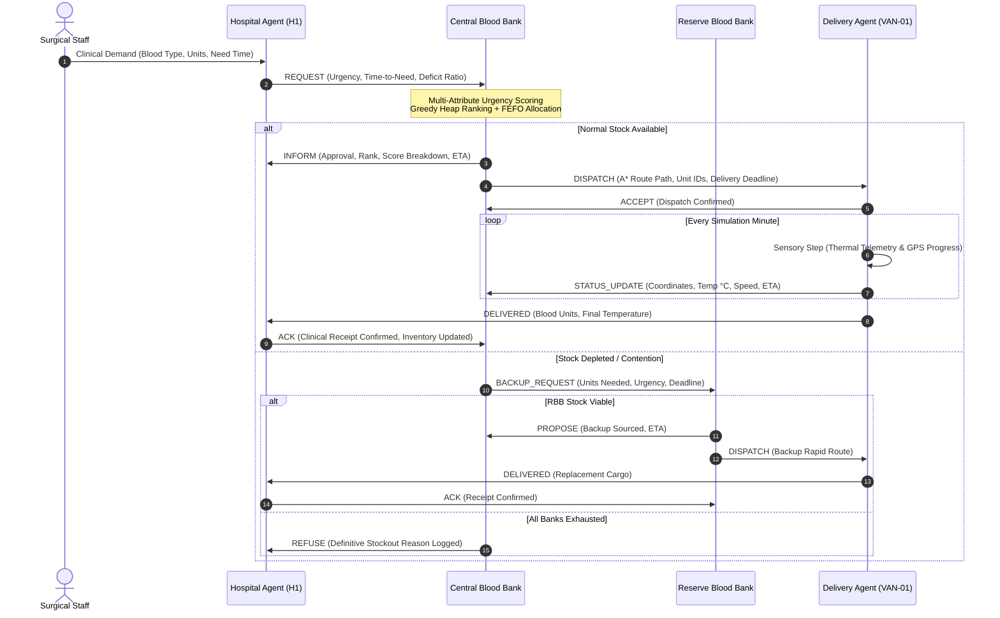

# Multi-Agent Blood Supply & Cold-Chain Management System

[](https://www.python.org/)
[](https://streamlit.io/)
[](https://plotly.com/)
[](https://pytest.org/)
[]()
[]()

> **Autonomous Clinical Logistics & Perishable Cold-Chain Safety**  
> An autonomous multi-agent logistics platform modeling urban blood banking networks. Engineered with hand-crafted AI algorithms, mathematically proven admissible heuristics ($A^*$), multi-criteria priority optimization, horn-clause forward-chaining safety rule engines, and real-time FIPA-ACL communicative negotiation.

---

## 📑 Table of Contents
1. [Executive Overview & Clinical Context](#-executive-overview--clinical-context)
2. [Multi-Agent System Architecture](#-multi-agent-system-architecture)
3. [Core AI Algorithms & Mathematical Formulations](#-core-ai-algorithms--mathematical-formulations)
   - [Multi-Attribute Urgency Scoring & Greedy Allocation](#1-multi-attribute-urgency-scoring--greedy-allocation)
   - [Hand-Crafted A* Pathfinding & Heuristic Admissibility Proof](#2-hand-crafted-a-pathfinding--heuristic-admissibility-proof)
   - [First-Expiry-First-Out (FEFO) Shelf-Life Sorting](#3-first-expiry-first-out-fefo-shelf-life-sorting)
   - [Horn-Clause Safety Rule Engine & Dual-Bank Backup Sourcing](#4-horn-clause-safety-rule-engine--dual-bank-backup-sourcing)
   - [RBC Compatibility Matrix & Substitution Rules](#5-rbc-compatibility-matrix--substitution-rules)
4. [In-Depth Explanation of All Preset Scenarios](#-in-depth-explanation-of-all-preset-scenarios)
   - [Scenario 1: Single Routine Request](#scenario-1-single-routine-request)
   - [Scenario 2: Two Hospitals Competing for Scarce O-](#scenario-2-two-hospitals-competing-for-scarce-o-)
   - [Scenario 3: Mass-Casualty Incident (4 Hospitals at Once)](#scenario-3-mass-casualty-incident-4-hospitals-at-once)
   - [Scenario 4: Temperature Breach Mid-Delivery → Backup from Reserve](#scenario-4-temperature-breach-mid-delivery--backup-from-reserve)
   - [Scenario 5: Traffic Jam (A* Dynamic Re-Routing)](#scenario-5-traffic-jam-a-dynamic-re-routing)
   - [Scenario 6: Stockout → Compatible Substitution](#scenario-6-stockout--compatible-substitution)
5. [User Interface & Operations Dashboard](#-user-interface--operations-dashboard)
6. [Quickstart & Installation](#-quickstart--installation)
7. [Automated Verification & Test Suite](#-automated-verification--test-suite)
8. [Codebase Organization & Scalability](#-codebase-organization--scalability)

---

## 🌟 Executive Overview & Clinical Context

In emergency medicine and surgical trauma care, **blood supply logistics is a life-critical, multi-dimensional constrained optimization problem**. Blood products possess unique operational characteristics that make conventional supply chain models insufficient:

1. **Extreme Perishability:** Whole blood and packed red blood cells (PRBCs) have finite clinical shelf lives (typically 35–42 days, modeled on accelerated scales in simulation). Stock rotation must minimize discard rates without compromising surgical availability.
2. **Strict Cold-Chain Regulatory Boundaries:** Blood products must be maintained within a rigid thermal envelope of **$1.0^\circ\text{C}$ to $10.0^\circ\text{C}$** throughout transportation. Thermal violations degrade erythrocyte viability and risk hemolytic reactions; unmonitored temperature breaches necessitate mandatory cargo quarantine.
3. **Immunological Compatibility Constraints:** Blood transfusions are bound by ABO and Rh(D) antigen-antibody compatibility. While exact-match units are preferred, stockouts require clinically valid cross-group substitutions (e.g., $O^-$ universal donor units).
4. **Demand Contention & Starvation Prevention:** When mass casualties or concurrent emergency surgeries deplete blood bank reserves, the system must dynamically arbitrate allocation based on patient urgency, surgical deficit, and remaining time-to-need ($T_{need}$), while guaranteeing that lower-urgency elective requests are not starved indefinitely.

This platform implements a **decentralized, autonomous Multi-Agent System (MAS)** that coordinates hospitals, blood banks, and delivery vehicles to solve these challenges in real time over a digitized city road topology.

---

## 🤖 Multi-Agent System Architecture

The system is constructed with fully decoupled, autonomous agents communicating over an asynchronous in-memory `MessageBus` using **FIPA-ACL** (Foundation for Intelligent Physical Agents - Agent Communication Language) standard performatives.

```
                           +-------------------------------------+
                           |            MessageBus               |
                           |  (Decoupled FIPA-ACL Message Queue) |
                           +--+---------------+---------------+--+
                              |               |               |
             +----------------+               |               +----------------+
             |                                |                                |
             v                                v                                v
+--------------------------+    +--------------------------+    +--------------------------+
|      Hospital Agents     |    |     Blood Bank Agents    |    |      Delivery Agents     |
|   (H1, H2, H3, H4, H5)   |    |    (Central & Reserve)   |    | (VAN-01, VAN-02, VAN-03) |
+--------------------------+    +--------------------------+    +--------------------------+
| - Monitor bed capacity   |    | - Real-time inventory    |    | - Hand-crafted A* motion |
| - Track local deficits   |    | - Multi-criteria scoring |    | - Telemetry broadcasting |
| - Calculate time-to-need |    | - FEFO shelf-life sort   |    | - Onboard thermal sensor |
| - Issue REQUEST & ACK    |    | - Autonomous dispatch    |    | - Dynamic re-routing     |
+--------------------------+    +--------------------------+    +--------------------------+
```

### Agent Roles & Behavioral Profiles

| Agent Type | Identifiers | Core Capabilities & Decision Cycles |
| :--- | :--- | :--- |
| **Hospital Agent** | `H1`–`H5` | Evaluates clinical bed utilization, determines blood unit deficits across 8 blood groups, predicts surgical need deadlines ($T_{need}$), and initiates `REQUEST` performatives. Validates cold-chain integrity upon cargo arrival before emitting `ACK`. |
| **Central Blood Bank (CBB)** | `CBB` | Regional primary distribution hub. Aggregates incoming hospital requirements, executes multi-attribute priority ranking, manages inventory rotation (FEFO), assigns dispatch routes to active delivery vehicles, and orchestrates peer negotiations. |
| **Reserve Blood Bank (RBB)** | `RBB` | Strategic contingency reserve. Holds backup inventory for critical trauma overflow and cold-chain breach recovery. Processes `BACKUP_REQUEST` performatives from CBB and dispatches rapid replacement deliveries. |
| **Delivery Agent** | `VAN-01`–`VAN-04` | Autonomous physical transit agents. Computes point-to-point routes using hand-crafted $A^*$ search, updates edge traversal telemetry, simulates thermal dynamics with ambient temperature exchange, and triggers immediate alerts upon thermal anomalies. |

### FIPA-ACL Communication Protocol

Agents exchange strongly-typed `Message` records containing standard metadata: `performative`, `sender`, `receiver`, `timestamp`, `conversation_id`, and structured `payload`.



---

## 🧠 Core AI Algorithms & Mathematical Formulations

### 1. Multi-Attribute Urgency Scoring & Greedy Allocation

To prevent ad-hoc allocation during clinical demand spikes, the Central Blood Bank applies a **multi-attribute greedy priority allocation algorithm**. When the simulation clock advances, pending requests are evaluated through a linear scalarized utility function:

$$\text{Total Score}(R_i) = w_1 \cdot U_i + w_2 \cdot \left(\frac{60}{\max(5, T_{\text{need}, i})}\right) + w_3 \cdot D_i + w_4 \cdot \text{Rarity}(B_i) + w_5 \cdot (\Delta t_{\text{wait}, i} \times 0.1)$$

#### Component Breakdown:
- **Clinical Urgency ($U_i$):** Quantified as $U \in \{3.0 (\text{Emergency}), 2.0 (\text{Urgent}), 1.0 (\text{Routine})\}$.
- **Imminent Need Penalty ($T_{\text{need}, i}$):** Scaled inversely such that a surgery needed in 15 minutes receives significantly higher weight ($60 / 15 = 4.0$) than a surgery scheduled in 120 minutes ($60 / 120 = 0.5$).
- **Local Hospital Deficit ($D_i$):** Computed from hospital target and current inventory levels:
  $$D_i = \max\left(0, \frac{\text{Target Stock} - \text{Current Stock}}{\text{Target Stock}}\right) \times 3.0$$
- **Blood Type Rarity ($\text{Rarity}(B_i)$):** Reflects population scarcity and universal utility ($O^- = 1.0$, $B^- = 0.8$, $A^- = 0.7$, $AB^- = 0.7$, $O^+ = 0.5$, $A^+ = 0.4$, $B^+ = 0.3$, $AB^+ = 0.2$).
- **Starvation Prevention Aging Bonus ($\Delta t_{\text{wait}, i}$):** Measures elapsed simulation minutes since initial request emission. Prevents lower-urgency routine surgeries from being permanently starved during prolonged trauma influxes.

#### Allocation Execution:
1. Pending requests are loaded into a priority queue (**max-heap** via Python's `heapq`, $O(N \log N)$ complexity).
2. The highest-scoring request populates available donor units.
3. Each candidate unit is selected via **FEFO (First-Expiry-First-Out)**.
4. If identical donor stock is depleted, the RBC Compatibility Matrix is evaluated for compatible substitutes.
5. Every decision is recorded with its full vector breakdown ($w_1 \cdot U, w_2 \cdot T, \dots$) and final disposition (`FULFILLED`, `PARTIAL`, or `REFUSED`).

---

### 2. Hand-Crafted A* Pathfinding & Heuristic Admissibility Proof

Vehicle movement across the city network is computed using an independent, hand-crafted $A^*$ search algorithm implemented from first principles (no third-party shortest path solvers).

#### Cost Formulation:
For any directed road edge between junction $u$ and junction $v$:

$$g(u, v) = \frac{\text{Distance}_{\text{km}}(u, v)}{\text{Effective Speed}_{\text{km/h}}(u, v)} \times 60.0 \quad [\text{minutes}]$$

Where:
$$\text{Effective Speed}(u, v) = \frac{\text{Base Speed}(u, v)}{\text{Delay Factor}(u, v)}, \quad \text{Delay Factor} \ge 1.0$$

#### Admissible & Consistent Heuristic:
$$h(n, \text{Goal}) = \frac{\text{Euclidean Distance}_{\text{km}}(n, \text{Goal})}{\text{Max Network Speed}_{\text{km/h}}} \times 60.0$$

#### Mathematical Proof of Admissibility & Optimality:
1. **Admissibility ($h(n) \le h^*(n)$):** In any 2D Euclidean topology, the straight-line distance is the infimum of all physical road curve lengths:
   $$\text{Dist}_{\text{Euclidean}}(n, \text{Goal}) \le \text{Dist}_{\text{Road Path}}(n, \text{Goal})$$
2. The physical transit speed on any road edge cannot exceed the maximum theoretical network speed ($\text{Max Speed} = 60.0 \text{ km/h}$). Because $\text{Delay Factor} \ge 1.0$:
   $$\text{Effective Speed}(u, v) \le \text{Max Speed} \quad \forall (u, v) \in E$$
3. Therefore:
   $$\frac{\text{Dist}_{\text{Euclidean}}(n, \text{Goal})}{\text{Max Speed}} \le \frac{\text{Dist}_{\text{Road Path}}(n, \text{Goal})}{\text{Effective Speed}} = g^*(n, \text{Goal})$$
   Thus, $h(n)$ never overestimates the actual travel time to the destination.
4. **Consistency (Monotonicity):** For any adjacent nodes $n$ and $n'$, the triangle inequality guarantees that $\text{Dist}(n, \text{Goal}) \le \text{Dist}(n, n') + \text{Dist}(n', \text{Goal})$. Dividing across by constant $\text{Max Speed}$ maintains the inequality $h(n) \le c(n, n') + h(n')$.
5. **Optimality:** Because $h(n)$ is both admissible and consistent on a graph with positive edge weights, $A^*$ is guaranteed to find the globally time-optimal trajectory without reopening expanded nodes.

---

### 3. First-Expiry-First-Out (FEFO) Shelf-Life Sorting

When units of an identical or compatible blood type are available in blood bank inventory, the allocation engine sorts candidates by remaining shelf life ascending:

$$\text{Sort Key}(U_k) = t_{\text{expiry}}(U_k) = t_{\text{pack}} + \text{ShelfLife}_{\text{mins}}$$

This guarantees that older viable blood units are prioritized for immediate dispatch, mitigating avoidable product expiration in regional banks.

---

### 4. Horn-Clause Safety Rule Engine & Dual-Bank Backup Sourcing

Safety rules are evaluated prior to agent step execution using a forward-chaining rule engine:

$$\begin{aligned}
\text{Rule 1 (Hyperthermia Breach): } & \bigwedge_{k=0}^{D-1} \left( T(t - k) > T_{\text{max}} \right) \implies \text{QuarantineCargo}() \land \text{EmitBreachAlert}() \\
\text{Rule 2 (Hypothermia Breach): } & \bigwedge_{k=0}^{D-1} \left( T(t - k) < T_{\text{min}} \right) \implies \text{QuarantineCargo}() \land \text{EmitBreachAlert}() \\
\text{Rule 3 (Product Expiration): } & t_{\text{sim}} \ge t_{\text{expiry}}(\text{Unit}) \implies \text{SetStatus}(\text{Unit}, \text{EXPIRED})
\end{aligned}$$

- **Thermal Bounds:** $T_{\text{min}} = 1.0^\circ\text{C}$, $T_{\text{max}} = 10.0^\circ\text{C}$.
- **Debounce Persistence ($D$):** 3 consecutive simulation readings (filters momentary sensor noise).

#### Dual-Bank Backup Sourcing Decision:
When a delivery vehicle suffers a confirmed cold-chain breach, the spoiled cargo is quarantined immediately. The Central Blood Bank simultaneously initiates emergency replacement routing by calculating the $A^*$ travel cost from both banks to the destination hospital:

$$\text{Source}^* = \arg\min_{B \in \{\text{CBB}, \text{RBB}\}} \left( A^*(B, H_{\text{dest}}) \right) \quad \text{subject to } \text{ViableStock}(B, \text{BloodType}) \ge \text{Units}$$

The closer facility with viable inventory immediately dispatches an emergency replacement vehicle (`is_backup=True`).

---

### 5. RBC Compatibility Matrix & Substitution Rules

When an exact blood type is exhausted in primary inventory, the clinical allocation engine queries the **Red Blood Cell (RBC) Antigen-Antibody Compatibility Matrix**:

| Recipient Type | Permissible Donor Blood Groups (in preference order) |
| :---: | :--- |
| **$O^-$** | $O^-$ only *(Strict universal donor)* |
| **$O^+$** | $O^+$, $O^-$ |
| **$A^-$** | $A^-$, $O^-$ |
| **$A^+$** | $A^+$, $A^-$, $O^+$, $O^-$ |
| **$B^-$** | $B^-$, $O^-$ |
| **$B^+$** | $B^+$, $B^-$, $O^+$, $O^-$ |
| **$AB^-$**| $AB^-$, $A^-$, $B^-$, $O^-$ |
| **$AB^+$**| $AB^+$, $AB^-$, $A^+$, $A^-$, $B^+$, $B^-$, $O^+$, $O^-$ *(Universal recipient)* |

If compatible units are substituted, the decision is flagged as `SUBSTITUTED` in the audit log, recording the exact donor unit IDs utilized.

---

## 🎮 In-Depth Explanation of All Preset Scenarios

The operations dashboard features **6 interactive, pre-configured clinical scenarios**. Each scenario isolates and verifies specific algorithmic and multi-agent capabilities.

```
+---------------------------------------------------------------------------------------------------+
| PRESET DEMONSTRATION SCENARIOS OVERVIEW                                                           |
+---+---------------------------------------------------------+-------------------------------------+
| # | Scenario Title                                          | Core AI Concept Demonstrated        |
+---+---------------------------------------------------------+-------------------------------------+
| 1 | Single Routine Request                                  | Baseline FIPA-ACL & A* Transit      |
| 2 | Two Hospitals Competing for Scarce O-                   | Priority Contention & Starvation    |
| 3 | Mass-Casualty Incident (4 Hospitals at Once)            | Multi-Request Heap Arbitration      |
| 4 | Temperature Breach Mid-Delivery -> Backup from Reserve  | Safety Rule Quarantine & Backup Svc |
| 5 | Traffic Jam (A* Dynamic Re-Routing)                     | Real-Time Heuristic Replanning      |
| 6 | Stockout -> Compatible Substitution                     | Immunological RBC Cross-Matching    |
+---+---------------------------------------------------------+-------------------------------------+
```

---

### Scenario 1: Single Routine Request
*Baseline autonomous allocation, point-to-point $A^*$ pathfinding, and full FIPA-ACL negotiation.*

- **Clinical Setup:**
  - **Hospital:** City General (`H1`).
  - **Requirement:** 2 units of $A^+$ (Routine surgery, $T_{\text{need}} = 90.0$ min).
  - **Initial Inventory:** Abundant $A^+$ stock at Central Blood Bank (`CBB`).
- **Algorithmic Execution:**
  1. `H1` submits a `REQUEST` to `CBB`.
  2. `CBB` runs multi-criteria scoring. Because stock is plentiful and no competing requests exist, the request is ranked #1 and marked `FULFILLED`.
  3. `CBB` executes $A^*$ pathfinding from `CBB` to `H1`: Path is `CBB ➔ J1 ➔ H1` (~9.4 min transit).
  4. Two units of $A^+$ are allocated via FEFO and loaded into delivery vehicle `VAN-01`.
  5. `VAN-01` departs, broadcasting periodic `STATUS_UPDATE` telemetry. Upon arrival, `H1` verifies temperature compliance and returns an `ACK`.
- **Observed Dashboard Behavior:**
  - **KPI Strip:** Requests: 1, Fulfilled: 1, In Transit: 0 / 2 Delivered, Breaches: 0.
  - **Map Visualizer:** Route callout card displays active transit path; completed delivery renders as a dotted emerald trail with a delivery success badge.
  - **Allocation Table:** 1 record: $A^+$, 2 requested, 2 allocated, `FULFILLED`, `On time`.

---

### Scenario 2: Two Hospitals Competing for Scarce O-
*Contention resolution under extreme supply scarcity, multi-attribute scoring weights, and starvation prevention.*

- **Clinical Setup:**
  - **Hospital A:** City General (`H1`) submits an **Emergency** need for 2 units of $O^-$ ($T_{\text{need}} = 15.0$ min, polytrauma shock).
  - **Hospital B:** Apollo (`H3`) submits a **Routine** need for 2 units of $O^-$ ($T_{\text{need}} = 120.0$ min, scheduled sickle cell transfusion).
  - **Available Stock:** Total $O^-$ stock at `CBB` is restricted to exactly **2 units**. `RBB` $O^-$ stock is also depleted to test refusal handling.
- **Algorithmic Execution:**
  1. Both hospitals emit concurrent `REQUEST` messages into `CBB`'s queue.
  2. Multi-attribute utility scores are computed:
     - `H1` Score: Urgency (3.0 × 3.0) + Time ($60/15 \times 2.0 = 8.0$) + Deficit + Rarity ($1.0 \times 1.5$) $\approx \mathbf{20.9}$.
     - `H3` Score: Urgency (1.0 × 3.0) + Time ($60/120 \times 2.0 = 1.0$) + Deficit + Rarity ($1.0 \times 1.5$) $\approx \mathbf{6.2}$.
  3. `CBB` allocates the remaining 2 units of $O^-$ exclusively to `H1` (`FULFILLED`).
  4. `H3` is evaluated next. Because zero $O^-$ units remain, `CBB` contacts `RBB` via `BACKUP_REQUEST`.
  5. `RBB` confirms zero stock and replies with `REFUSE`. `CBB` logs an explicit `REFUSED` decision for `H3` citing stock exhaustion.
- **Observed Dashboard Behavior:**
  - **KPI Strip:** Requests: 2, Fulfilled: 1 (0 partial / 1 refused), Delivered: 2 units, On time.
  - **Allocation Matrix:**
    - `H1`: Score ~20.9, Outcome `Fulfilled`, Delivery `On time`.
    - `H3`: Score ~6.2, Outcome `Refused`, Reason: Stock depleted.

---

### Scenario 3: Mass-Casualty Incident (4 Hospitals at Once)
*High-concurrency trauma queue arbitration across multiple blood groups.*

- **Clinical Setup:**
  - **Incident:** Multiple major trauma events across the city.
  - **H1 (City General):** 3 units $O^-$ (Emergency, $T_{\text{need}} = 15$ min, Highway collision).
  - **H2 (St. Mary's):** 4 units $A^+$ (Emergency, $T_{\text{need}} = 20$ min, Industrial explosion).
  - **H4 (Govt Medical College):** 3 units $B^+$ (Urgent, $T_{\text{need}} = 45$ min, Obstetric hemorrhage).
  - **H5 (Children's Hospital):** 2 units $O^+$ (Urgent, $T_{\text{need}} = 60$ min, Pediatric surgery).
- **Algorithmic Execution:**
  1. All 4 requirements are ingested into `CBB`'s pending queue.
  2. `greedy_priority_allocation()` ranks all 4 requests into a max-heap:
     - Rank 1: `H1` ($O^-$, Emergency)
     - Rank 2: `H2` ($A^+$, Emergency)
     - Rank 3: `H4` ($B^+$, Urgent)
     - Rank 4: `H5` ($O^+$, Urgent)
  3. Inventory is allocated in strict score order using FEFO shelf-life ordering.
  4. Delivery fleet dispatches vehicles along optimal $A^*$ trajectories.
- **Observed Dashboard Behavior:**
  - **Allocation Table:** Displays complete 4-row matrix with color-coded stacked bar breakdowns (Urgency, Time-to-Need, Deficit, Rarity, Waiting).
  - **Map Visualizer:** Multiple simultaneous delivery traces animating across the urban road topology.

---

### Scenario 4: Temperature Breach Mid-Delivery → Backup from Reserve
*Forward-chaining safety rule execution, cargo quarantine, and dual-bank backup sourcing.*

- **Clinical Setup:**
  - **Hospital:** Govt Medical College (`H4`).
  - **Requirement:** 2 units of $B^-$ (Emergency, $T_{\text{need}} = 25$ min).
  - **Distances:** `H4` is situated closer to the Reserve Blood Bank (`RBB`) than `CBB`.
- **Algorithmic Execution:**
  1. `CBB` allocates 2 units of $B^-$ and dispatches vehicle `VAN-01`.
  2. At simulation $T+2.0$, a refrigeration failure is injected: onboard temperature spikes above $10.0^\circ\text{C}$.
  3. The Horn-clause rule engine detects 3 consecutive out-of-band readings ($T > 10.0^\circ\text{C}$).
  4. **Rule 1 fires:** `VAN-01` marks cargo `QUARANTINED` and transmits `BREACH_ALERT` to `CBB`.
  5. `CBB` compares $A^*$ travel times to `H4`:
     - $A^*(CBB, H4) \approx 13.8$ min
     - $A^*(RBB, H4) \approx 7.2$ min
  6. `CBB` determines `RBB` is closer and emits `BACKUP_REQUEST` to `RBB`.
  7. `RBB` accepts, allocates replacement units from reserve inventory, and dispatches backup vehicle `VAN-03`.
  8. `VAN-03` completes rapid emergency delivery to `H4` within clinical deadlines.
- **Observed Dashboard Behavior:**
  - **KPI Strip:** Breaches: 1 (quarantined and highlighted in critical red).
  - **Breach Alert Banner:** Prominent red callout displaying vehicle ID, temperature, and backup sourcing action.
  - **Telemetry Graph:** Temperature curve spikes above the red dashed upper bound ($10^\circ\text{C}$), followed by the backup vehicle's compliant telemetry curve ($2^\circ\text{C} - 4^\circ\text{C}$).

---

### Scenario 5: Traffic Jam (A* Dynamic Re-Routing)
*Real-time heuristic replanning under sudden road network disruption.*

- **Clinical Setup:**
  - **Hospital:** Children's Hospital (`H5`).
  - **Requirement:** 2 units of $AB^+$ (Urgent, $T_{\text{need}} = 40$ min).
  - **Network Perturbation:** A severe traffic obstruction is injected on the primary Central Arterial corridor (`CBB ➔ J4`), increasing edge delay factor to **3.0x**.
- **Algorithmic Execution:**
  1. Under baseline clear conditions, the shortest route from `CBB` to `H5` is `CBB ➔ J4 ➔ H5` (~13.1 min).
  2. With the 3.0x delay applied to `CBB ➔ J4`, the effective travel time across that edge surges from 8.5 min to 25.5 min.
  3. The delivery vehicle evaluates route options using $A^*$:
     - Path A (`CBB ➔ J4 ➔ H5`): $25.5 + 4.6 = 30.1$ min.
     - Path B (`CBB ➔ J1 ➔ J3 ➔ H5` via Western Avenue): $5.0 + 7.5 + 6.0 = 18.5$ min.
  4. $A^*$ autonomously discovers and adopts Path B, avoiding the congested central corridor and saving over 11 minutes in transit time.
- **Observed Dashboard Behavior:**
  - **Map Visualizer:** The congested road segment (`CBB–J4`) highlights in bold crimson; the active delivery route visualizer displays the vehicle taking the outer western bypass corridor.
  - **Route Callout Card:** Explicitly details the alternate waypoint hops and revised transit time.

---

### Scenario 6: Stockout → Compatible Substitution
*Clinical erythrocyte antigen cross-matching under exact-match inventory depletion.*

- **Clinical Setup:**
  - **Hospital:** St. Mary's (`H2`).
  - **Requirement:** 3 units of $B^+$ (Urgent, $T_{\text{need}} = 35$ min).
  - **Inventory Constraint:** $B^+$ inventory at Central Blood Bank is **completely depleted** (0 units available).
  - **Compatible Stock:** Central Bank holds sufficient universal donor $O^+$ units.
- **Algorithmic Execution:**
  1. `H2` submits `REQUEST` for 3 units of $B^+$.
  2. `CBB` checks exact stock for $B^+$: Available = 0.
  3. Allocation invokes the RBC Compatibility Matrix for recipient $B^+$:
     - Permissible donor hierarchy: $[B^+, B^-, O^+, O^-]$.
  4. Engine finds available $O^+$ units and allocates 3 units of $O^+$ under FEFO shelf-life ordering.
  5. The decision is recorded as `FULFILLED` with an explicit notice: `Compatible donor substitution: O+ allocated for B+ requirement`.
- **Observed Dashboard Behavior:**
  - **Allocation Decision Table:** Shows requested type as $B^+$, allocated type as $O^+$, outcome `Fulfilled`, with full substitution explanation.
  - **Delivery Card:** Details that 3 units of compatible $O^+$ are en route to `H2`.

---

## 🖥️ User Interface & Operations Dashboard

The dashboard provides a high-density, real-time command center built for clinical logistics coordinators.

```
+--------------------------------------------------------------------------------------------------+
| MULTI-AGENT BLOOD SUPPLY & COLD-CHAIN MANAGEMENT                                     CLOCK: T+12 |
+--------------------------------------------------------------------------------------------------+
| [ REQUESTS ]           [ FULFILLED ]            [ IN TRANSIT / DELIV ]       [ BREACHES ]        |
| 2                      1                        0 / 2                        0                   |
| 0 pending              0 partial / 1 refused    On time · 2 delivered        0 within safe band  |
+--------------------------------------------------------------------------------------------------+
| REGIONAL NETWORK MAP (60%)                      | CLINICAL INTAKE & INVENTORY (40%)              |
| +---------------------------------------------+ | +--------------------------------------------+ |
| | [✓ Delivery Completed (On time)]            | | | PENDING REQUIREMENTS                       | |
| | Delivered 2 units (O-) to H1 via VAN-01     | | | - No unallocated requests pending          | |
| |                                             | | +--------------------------------------------+ |
| |  [H1] -------- [J1] -------- [CBB]          | | | CENTRAL BANK STOCK                         | |
| |    \             |             /            | | | O+ [====================] 18               | |
| |     \            |            /             | | | O- [====] 4                                | |
| |     [J3] ------ [J4] ------ [J2]            | | | A+ [==============  ] 12                   | |
| |       \          |         /   \            | | | ...                                        | |
| |       [H5]     [H4]      [H2]  [RBB]        | | +--------------------------------------------+ |
| +---------------------------------------------+ | [ Quick Hospital Intake: H1 | H2 | H3 | H4 ] | |
+--------------------------------------------------------------------------------------------------+
| ALLOCATION RESULT (Greedy Priority Score Breakdown Table)                                        |
+--------------------------------------------------------------------------------------------------+
| DELIVERIES & REAL-TIME COLD-CHAIN TEMPERATURE TELEMETRY GRAPH                                    |
+--------------------------------------------------------------------------------------------------+
| AGENT COMMUNICATION LOG & FIPA-ACL INTERACTION TIMELINE                                          |
+--------------------------------------------------------------------------------------------------+
```

### Dashboard Features:
1. **Clinical KPI Strip:** Real-time consolidated counters: total requests received, fulfilled/partial/refused split, active in-transit vehicles vs units delivered, and quarantined breach tallies.
2. **Prominent Route & Delivery Status Callout Card:** Positioned above the map; displays active waypoints (`➔`), vehicle IDs, transit speeds, remaining ETAs, and cold-chain status.
3. **Interactive 2D Topology Visualizer:** Displays hospitals, blood banks, junctions, and roads. Includes active vehicle markers with direction labels (`🚐 VAN-01 ➔ City General`) and completed green delivery traces. Clicking any hospital opens a clinical intake modal.
4. **Interactive Clinical Request Dialog (`@st.dialog`):** Allows users to submit custom blood requests on demand, specifying blood type, units, clinical urgency, time-to-need, and surgical indication.
5. **Allocation Decision Matrix:** Full transparency into algorithm scoring. Displays rank, hospital, blood type, units allocated, total score, and a stacked color-coded bar visualizing individual score components (Urgency, Time-to-Need, Deficit, Rarity, Waiting).
6. **Live Sensor Telemetry:** Real-time Plotly line chart plotting vehicle internal temperature readings against upper ($10^\circ\text{C}$) and lower ($1^\circ\text{C}$) safety boundaries.
7. **FIPA-ACL Interaction Timeline:** Interactive sequence-style chart documenting every message exchange between agents.

---

## 🚀 Quickstart & Installation

### 1. System Requirements
- Python 3.11, 3.12, or 3.13
- Git

### 2. Installation
```bash
# Clone repository
git clone https://github.com/Gnanesh-12/Multi-Agent-Blood-Supply-and-Cold-Chain-Management.git
cd Multi-Agent-Blood-Supply-and-Cold-Chain-Management

# Create and activate virtual environment
python -m venv venv

# Windows (PowerShell):
.\venv\Scripts\Activate.ps1
# Windows (Command Prompt):
venv\Scripts\activate.bat
# Linux/macOS:
source venv/bin/activate

# Install dependencies
pip install -r requirements.txt
```

### 3. Launching the Platform
```bash
streamlit run app.py
```
Open [http://localhost:8501](http://localhost:8501) in any modern browser.

---

## 🧪 Automated Verification & Test Suite

The system includes a test suite covering algorithmic optimality, edge cases, safety rules, and seed determinism.

```bash
python -m pytest
```

### Test Suite Coverage:

| Test Module | Test Focus & Verification Criteria |
| :--- | :--- |
| [`tests/test_astar.py`](file:///c:/Users/GNANESH%20KHANDAVILLI/OneDrive/Desktop/Gnanesh/Multi-Agent-Blood-Supply-and-Cold-Chain-Management/tests/test_astar.py) | - Validates $A^*$ optimality against uniform-cost Dijkstra.<br>- Verifies Euclidean heuristic admissibility ($h(n) \le h^*(n)$ across all node pairs).<br>- Tests dynamic re-routing when edge delay factors increase. |
| [`tests/test_allocation.py`](file:///c:/Users/GNANESH%20KHANDAVILLI/OneDrive/Desktop/Gnanesh/Multi-Agent-Blood-Supply-and-Cold-Chain-Management/tests/test_allocation.py) | - Validates multi-attribute scoring ranking order.<br>- Proves aging term prevents starvation of low-urgency routine requests.<br>- Verifies FEFO shelf-life sorting.<br>- Verifies RBC compatibility substitutions ($O^+$ for $B^+$, $O^-$ for $A^-$). |
| [`tests/test_rules.py`](file:///c:/Users/GNANESH%20KHANDAVILLI/OneDrive/Desktop/Gnanesh/Multi-Agent-Blood-Supply-and-Cold-Chain-Management/tests/test_rules.py) | - Tests hyperthermia ($>10^\circ\text{C}$) and hypothermia ($<1^\circ\text{C}$) breach counters.<br>- Verifies debouncing logic resets when readings return to safe band.<br>- Tests product shelf-life expiration rule. |
| [`tests/test_scenarios.py`](file:///c:/Users/GNANESH%20KHANDAVILLI/OneDrive/Desktop/Gnanesh/Multi-Agent-Blood-Supply-and-Cold-Chain-Management/tests/test_scenarios.py) | - End-to-end integration test of temperature breach and dual-bank backup sourcing.<br>- Validates FIPA-ACL message sequence and performatives.<br>- Tests simulation determinism across identical random seeds.<br>- Verifies KPI metrics maintain accurate accounting after full delivery completion. |
| [`tests/test_autonomous_allocation_and_deadlines.py`](file:///c:/Users/GNANESH%20KHANDAVILLI/OneDrive/Desktop/Gnanesh/Multi-Agent-Blood-Supply-and-Cold-Chain-Management/tests/test_autonomous_allocation_and_deadlines.py) | - Verifies autonomous greedy allocation triggers on clock step.<br>- Tests deadline calculation ($T_{\text{created}} + T_{\text{need}}$).<br>- Validates on-time vs late status determination. |
| [`tests/test_map_route_and_destination_visibility.py`](file:///c:/Users/GNANESH%20KHANDAVILLI/OneDrive/Desktop/Gnanesh/Multi-Agent-Blood-Supply-and-Cold-Chain-Management/tests/test_map_route_and_destination_visibility.py) | - Validates rendering of active glowing route traces.<br>- Verifies completed route emerald lines and destination status callout cards. |

---

## 🏛️ Codebase Organization & Scalability

```
Multi-Agent-Blood-Supply-and-Cold-Chain-Management/
├── app.py                      # Streamlit UI presentation layer (clean presentation only)
├── requirements.txt            # Pinned production dependencies
├── assets/
│   └── style.css               # Clinical design tokens, KPI cards, and typography
├── config/
│   └── city.yaml               # Network topology, coordinates, road speeds, initial stock
├── src/
│   ├── blood.py                # BloodType enum, BloodUnit, FEFO, RBC compatibility matrix
│   ├── city.py                 # CityNetwork topology, Euclidean distance, delay factors
│   ├── messaging.py            # FIPA-ACL performatives, Message dataclass, MessageBus
│   ├── rules.py                # Horn-clause SafetyRuleEngine (cold chain & shelf-life)
│   ├── simulation.py           # SimulationEngine coordinator (headless core)
│   ├── ui_helpers.py           # Base UI helpers
│   ├── agents/
│   │   ├── base.py             # BaseAgent (perceive-decide-act lifecycle)
│   │   ├── hospital.py         # HospitalAgent (clinical need & inventory tracking)
│   │   ├── blood_bank.py       # BloodBankAgent (CBB & RBB priority allocation & dispatch)
│   │   └── delivery.py         # DeliveryAgent (A* navigation, thermal sensory step)
│   ├── planning/
│   │   ├── astar.py            # Hand-crafted A* search & Dijkstra baseline
│   │   └── allocation.py       # Multi-criteria scoring, greedy heap, compatibility
│   └── ui/
│       ├── components.py       # Modular UI components (KPI strip, callout card, tables)
│       └── plot_theme.py       # Plotly figure builders (2D map, telemetry curves, timeline)
└── tests/
    ├── test_allocation.py
    ├── test_astar.py
    ├── test_autonomous_allocation_and_deadlines.py
    ├── test_map_route_and_destination_visibility.py
    ├── test_rules.py
    └── test_scenarios.py
```

### Key Engineering Principles:
1. **Zero Hardcoded Geography:** All hospital coordinates, bank locations, road connections, base velocities, and initial blood inventories are externalized in [config/city.yaml](file:///c:/Users/GNANESH%20KHANDAVILLI/OneDrive/Desktop/Gnanesh/Multi-Agent-Blood-Supply-and-Cold-Chain-Management/config/city.yaml). Adding a new medical center or adjusting regional traffic is achieved entirely via configuration.
2. **Headless & Testable Core:** The `SimulationEngine` contains zero Streamlit dependencies. It can run in continuous background mode, CLI scripts, or automated CI test harnesses.
3. **Decoupled Asynchronous Messaging:** Agents possess no private references to other agents' internals; all coordination occurs via explicit, auditable FIPA-ACL messages routed through the `MessageBus`.
4. **Deterministic Reproducibility:** Simulation runs accept an optional seed parameter ensuring that complex stochastic events (e.g. ambient thermal fluctuations) can be deterministically reproduced.

---

## 📜 License
This project is licensed under the MIT License - see the LICENSE file for details.
