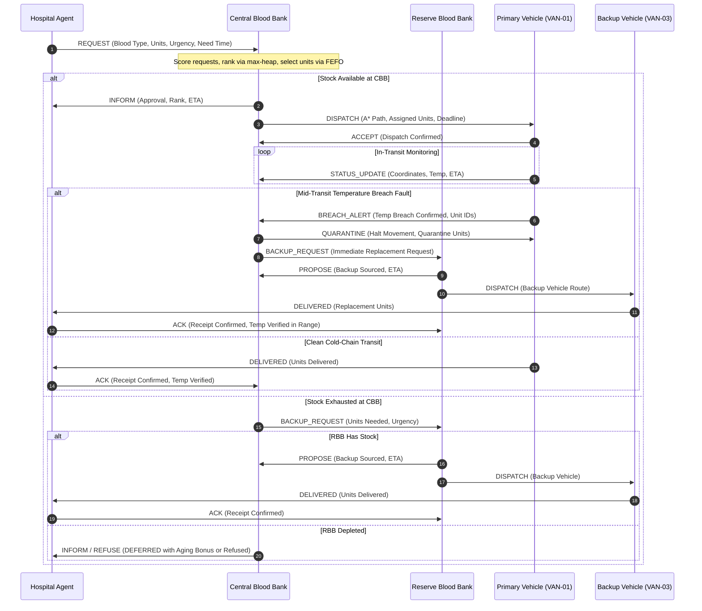

# Multi-Agent Blood Supply and Cold-Chain Management

[](https://www.python.org/)
[](LICENSE)

**Case Study Document:** [docs/CASE_STUDY.md](docs/CASE_STUDY.md) (Detailed PEAS analysis and Russell & Norvig environment characterization)

---

## Table of Contents
1. [Overview and Problem Context](#overview-and-problem-context)
2. [Six-Step UI Demo Walkthrough](#six-step-ui-demo-walkthrough)
3. [Tools and Why We Chose Them](#tools-and-why-we-chose-them)
4. [System Architecture and Interaction Protocol](#system-architecture-and-interaction-protocol)
5. [Algorithms and Mathematical Formulations](#algorithms-and-mathematical-formulations)
   - [Multi-Attribute Urgency Scoring and Greedy Allocation](#multi-attribute-urgency-scoring-and-greedy-allocation)
   - [Hand-Crafted A* Pathfinding and Admissibility Proof](#hand-crafted-a-pathfinding-and-admissibility-proof)
   - [First-Expiry-First-Out Shelf-Life Sorting](#first-expiry-first-out-shelf-life-sorting)
   - [Horn-Clause Safety Rules and Dual-Bank Sourcing](#horn-clause-safety-rules-and-dual-bank-sourcing)
   - [Red Blood Cell Compatibility Matrix](#red-blood-cell-compatibility-matrix)
6. [Scenario Walkthroughs and Experimental Results](#scenario-walkthroughs-and-experimental-results)
   - [Scenario 1: Single Routine Request](#scenario-1-single-routine-request)
   - [Scenario 2: Two Hospitals Competing for Scarce O-](#scenario-2-two-hospitals-competing-for-scarce-o-)
   - [Scenario 3: Mass-Casualty Incident (4 Hospitals)](#scenario-3-mass-casualty-incident-4-hospitals)
   - [Scenario 4: Temperature Breach Mid-Delivery -> Backup from Reserve](#scenario-4-temperature-breach-mid-delivery---backup-from-reserve)
   - [Scenario 5: Traffic-Aware Route Selection](#scenario-5-traffic-aware-route-selection)
   - [Scenario 6: Stockout -> Compatible Substitution](#scenario-6-stockout---compatible-substitution)
7. [Installation and Test Execution](#installation-and-test-execution)
8. [Codebase Structure](#codebase-structure)

---

## Overview and Problem Context

Hospital blood supply management involves strict operational constraints:
1. **Perishability:** Packed red blood cells (PRBCs) have finite shelf lives, requiring First-Expiry-First-Out (FEFO) inventory rotation to reduce spoilage.
2. **Cold-Chain Safety:** Blood units must remain between $1.0^\circ\text{C}$ and $10.0^\circ\text{C}$ during transit. Unmonitored heating or freezing degrades cell viability, requiring cargo quarantine.
3. **Immunological Compatibility:** Transfusions depend on ABO and Rh(D) compatibility rules. When exact matches are unavailable, compatible substitutions (e.g., $O^-$ donor units) must be identified.
4. **Demand Contention:** Under scarce supply, multiple hospitals contend for limited units. Allocations must prioritize emergency procedures and tight surgical deadlines without starving routine requests.

This project implements a **synchronous discrete-time simulation** of an urban blood banking network where software agents communicate exclusively through a centralized `MessageBus` routed by `SimulationEngine`.

---

## Six-Step UI Demo Walkthrough

The Streamlit web interface ([app.py](app.py)) provides an interactive view of the simulation:

1. **Select a Scenario or Click a Hospital:** Use the sidebar dropdown to choose one of the 6 preset scenarios (e.g., *2. Two Hospitals Competing for Scarce O-*), or click a hospital to raise a request interactively from the clinical intake dialog.
2. **Inspect Initial State:** Review the Regional Network Map, Central Bank stock levels, and queued requests in the callout card above the map.
3. **Step the Clock:** Click **Step 1 min** to advance simulation time ($\Delta t = 1.0$ min). The Central Blood Bank automatically runs priority allocation on pending requests and dispatches available delivery vehicles in score rank order.
4. **Monitor Active Transit & Inject Faults:** Observe delivery vans moving along road segments on the map, view waypoint hops in the Route Status card, and inspect live thermal readings. Click **Inject breach** to simulate a refrigeration failure mid-transit and observe immediate quarantine and backup dispatch.
5. **Fast-Forward to Completion:** Click **Run to end** to step the simulation continuously until all active deliveries finish.
6. **Analyze Results:** Review the four KPI cards (Requests, Fulfilled, In Transit / Delivered, Breaches), the Allocation Decisions table with multi-criteria score breakdowns, and the FIPA-ACL message timeline.

---

## Tools and Why We Chose Them

The system uses standard Python libraries pinned in [requirements.txt](requirements.txt):

| Package | Version | Purpose in this Project |
| :--- | :--- | :--- |
| **Streamlit** | `1.65.0` | UI presentation layer for interactive scenario loading, stepping, and clinical intake dialogs (`@st.dialog`). |
| **Plotly** | `6.9.0` | Interactive 2D road network maps, route traces, sensor temperature curves with safety bands, and FIPA-ACL timeline charts. |
| **NetworkX** | `3.6.1` | **Graph data structure storage only.** NetworkX stores junction nodes, road edges, lengths, and delay factors. **No NetworkX shortest path or routing algorithms are used.** |
| **pandas** | `3.0.2` | Dataframe formatting for tabular allocation history and message logs. |
| **PyYAML** | `6.0.3` | External configuration parser for [config/city.yaml](config/city.yaml). |
| **pytest** | `9.1.1` | Automated test suite validating heuristic admissibility, allocation fairness, and simulation determinism. |

### Architectural Rationale: Why Not Mesa or SPADE?

- **Why not Mesa?** Mesa provides scheduling/data collection but no agent messaging protocol; our model needed a message bus and A* on a road graph, which were simpler to implement directly.
- **Why not SPADE?** SPADE requires an external XMPP/Jabber server daemon and asynchronous network I/O. This introduces network latency, external process dependencies, and non-deterministic message arrival orders. For an educational simulation that requires deterministic test verification and synchronized time stepping, an in-memory `MessageBus` managed by `SimulationEngine` is more reliable and reproducible.

---

## System Architecture and Interaction Protocol

The simulation executes in synchronous discrete-time steps ($\Delta t = 1.0$ min). All agent coordination occurs via structured messages passed through the `MessageBus`.

```
                      +------------------------------------------+
                      |         SimulationEngine Clock           |
                      +--------------------+---------------------+
                                           | Step ticks
                                           v
+-----------------------------------------------------------------------------------+
|                        Decoupled MessageBus (FIPA-ACL)                            |
+-------------------+----------------------+--------------------+-------------------+
                    ^                      ^                    ^
                    |                      |                    |
+-------------------+------+  +------------+---------+  +-------+------------------+
|      Hospital Agents     |  |   Blood Bank Agents   |  |     Delivery Agents      |
|         (H1 to H5)       |  |      (CBB, RBB)       |  | (VAN-01, -02, -03, -04)  |
+--------------------------+  +-----------------------+  +--------------------------+
| - Track surgery schedule |  | - Urgency score heap  |  | - Custom A* navigation   |
| - Monitor local stock    |  | - FEFO shelf-life     |  | - Thermal sensor reading |
| - Send REQUEST           |  | - Route dispatch      |  | - Send STATUS_UPDATE     |
| - Verify temp log & ACK  |  | - Backup negotiation  |  | - Emit BREACH_ALERT      |
+--------------------------+  +-----------------------+  +--------------------------+
```

### Agent Roles

- **Hospital Agent (`H1` to `H5`):** Tracks local hospital stock and scheduled surgical needs. When stock is insufficient for upcoming surgeries, it calculates time-to-need ($T_{need}$) and submits a `REQUEST` message. Upon delivery, it inspects the vehicle temperature log and replies with `ACK`.
- **Central Blood Bank Agent (`CBB`):** Manages regional inventory. Receives hospital requests, computes multi-attribute scores, runs greedy heap allocation with FEFO rotation, and dispatches primary vehicles (`VAN-01`, `VAN-02`) by allocation rank.
- **Reserve Blood Bank Agent (`RBB`):** Maintains reserve buffer stock. When `CBB` experiences stockouts or temperature breaches, `RBB` processes `BACKUP_REQUEST` messages and dispatches reserve vehicles (`VAN-03`, `VAN-04`).
- **Delivery Agent (`VAN-01` to `VAN-04`):** Navigates the road network using hand-crafted $A^*$ search. Emits `STATUS_UPDATE` messages with position and temperature, monitors thermal sensor readings, and raises `BREACH_ALERT` if limits are exceeded.

### Interaction Sequence



---

## Algorithms and Mathematical Formulations

### Multi-Attribute Urgency Scoring and Greedy Allocation

When multiple requests are pending, `CBB` ranks them using a weighted multi-criteria scoring function defined in `src/planning/allocation.py`:

$$\text{Score} = w_1 \cdot U + w_2 \cdot \left(\frac{60}{\max(5, T_{need})}\right) + w_3 \cdot D + w_4 \cdot R + w_5 \cdot (\Delta t_{wait} \times 0.1)$$

#### Weights from `config/city.yaml`

| Weight | Parameter Name in Config | Default Value | Clinical Role |
| :---: | :--- | :---: | :--- |
| **$w_1$** | `w1_urgency_level` | `0.35` | Prioritizes clinical triaging: Emergency = 3.0, Urgent = 2.0, Routine = 1.0. |
| **$w_2$** | `w2_time_to_need` | `0.25` | Inversely scales minutes remaining ($60 / \max(5, T_{need})$), giving higher priority to imminent procedures. |
| **$w_3$** | `w3_deficit_ratio` | `0.15` | Scales local hospital deficit: $\max(0, (\text{Target} - \text{Current}) / \text{Target}) \times 3.0$. |
| **$w_4$** | `w4_blood_type_rarity` | `0.15` | Multiplies blood rarity factor ($O^- = 1.0, AB^- = 0.9, \dots, AB^+ = 0.2$) $\times 3.0$. |
| **$w_5$** | `w5_waiting_time` | `0.10` | Aging term: adds $0.1$ points per 10 simulation minutes waiting, preventing starvation of routine surgeries. |

Requests are stored in a max-heap (`heapq`) and popped in descending score order.

---

### Hand-Crafted A* Pathfinding and Admissibility Proof

Route navigation across the network is computed by `astar_search()` in `src/planning/astar.py`.

#### Edge Cost Function
For an edge $(u, v)$ with distance in kilometers and speed in km/h:

$$c(u, v) = \frac{\text{Distance}_{\text{km}}(u, v)}{\text{Effective Speed}_{\text{km/h}}(u, v)} \times 60.0 \quad [\text{minutes}]$$

Where:
$$\text{Effective Speed}(u, v) = \frac{\text{Base Speed}(u, v)}{\text{Delay Factor}(u, v)}, \quad \text{Delay Factor} \ge 1.0$$

#### Heuristic Function
The heuristic estimates remaining travel time using straight-line Euclidean distance divided by the theoretical maximum network speed:

$$h(n, \text{Goal}) = \frac{\text{Euclidean Distance}_{\text{km}}(n, \text{Goal})}{\text{Max Speed}_{\text{km/h}}} \times 60.0$$

Where $\text{Max Speed}_{\text{km/h}} = 70.0\text{ km/h}$, defined as `max_speed_kmh` in [config/city.yaml](config/city.yaml).

#### Proof of Admissibility and Consistency

1. **Admissibility ($h(n) \le h^*(n)$):**  
   In 2D space, straight-line distance is the shortest possible distance between two points:
   $$\text{Dist}_{\text{Euclidean}}(n, \text{Goal}) \le \text{Dist}_{\text{Road Path}}(n, \text{Goal})$$
   Because all road edge speeds satisfy $\text{Effective Speed}(u, v) \le \text{Base Speed}(u, v) \le \text{Max Speed} = 70.0\text{ km/h}$, the minimum time across any road segment is lower-bounded:
   $$\frac{\text{Dist}_{\text{Euclidean}}(n, \text{Goal})}{\text{Max Speed}} \le \frac{\text{Dist}_{\text{Road Path}}(n, \text{Goal})}{\text{Effective Speed}} = h^*(n)$$
   Hence, $h(n)$ never overestimates true travel time.

2. **Consistency (Monotonicity Condition):**  
   For any road edge from node $u$ to node $v$, the triangle inequality on Euclidean space ensures:
   $$\text{Dist}_{\text{Euclidean}}(u, \text{Goal}) \le \text{Dist}_{\text{Euclidean}}(u, v) + \text{Dist}_{\text{Euclidean}}(v, \text{Goal})$$
   Dividing through by the constant $\text{Max Speed} = 70.0\text{ km/h}$:
   $$h(u) \le \frac{\text{Dist}_{\text{Euclidean}}(u, v)}{\text{Max Speed}} \times 60.0 + h(v)$$
   Because the actual physical road distance satisfies $\text{Dist}_{\text{Road}}(u, v) \ge \text{Dist}_{\text{Euclidean}}(u, v)$ and $\text{Effective Speed}(u, v) \le \text{Max Speed}$, the edge cost satisfies:
   $$c(u, v) = \frac{\text{Dist}_{\text{Road}}(u, v)}{\text{Effective Speed}(u, v)} \times 60.0 \ge \frac{\text{Dist}_{\text{Euclidean}}(u, v)}{\text{Max Speed}} \times 60.0$$
   Therefore:
   $$h(u) \le c(u, v) + h(v)$$
   This satisfies the consistency condition, guaranteeing that node expansions are monotonic and optimal without reopening closed nodes.

> [!IMPORTANT]
> **Configuration Conditions Required by the A* Optimality Proof:**
> The mathematical proof of admissibility and consistency strictly relies on two physical configuration conditions in [config/city.yaml](config/city.yaml):
> 1. **Upper-Bounded Road Speeds:** The base speed of every edge does not exceed `max_speed_kmh`:
>    $$\forall (u, v) \in E: \quad \text{Base Speed}(u, v) \le \text{max\_speed\_kmh} \quad (55.0 \le 70.0\text{ km/h})$$
> 2. **Euclidean Lower Bound on Edge Distance:** Every road edge length is greater than or equal to the straight-line Euclidean distance between its endpoint coordinates:
>    $$\forall (u, v) \in E: \quad \text{Distance}_{\text{km}}(u, v) \ge \|\mathbf{p}_u - \mathbf{p}_v\|_2$$
>
> Both conditions are actively validated at startup inside `CityNetwork.load_from_config()` in [src/city.py](src/city.py), preventing any invalid topology from breaking $A^*$ optimality guarantees.

---

### First-Expiry-First-Out Shelf-Life Sorting

When units of the requested blood type are available, the allocation engine sorts units by expiration timestamp ascending:

$$\text{Sort Key}(U_k) = t_{\text{expiry}}(U_k) = t_{\text{pack}} + \text{ShelfLife}_{\text{minutes}}$$

Units closest to expiration are allocated first to minimize clinical waste.

---

### Horn-Clause Safety Rules and Dual-Bank Sourcing

Safety rules are evaluated on each simulation step:
- **Hyperthermia:** Temperature $> 10.0^\circ\text{C}$ for $\ge 3$ consecutive readings $\implies$ Quarantine cargo and trigger backup.
- **Hypothermia:** Temperature $< 1.0^\circ\text{C}$ for $\ge 3$ consecutive readings $\implies$ Quarantine cargo and trigger backup.
- **Expiration:** Simulation time $\ge t_{\text{expiry}}(\text{Unit}) \implies$ Set unit status to `EXPIRED`.

When a breach is confirmed, `CBB` calculates $A^*$ transit times from both banks to the destination hospital:

$$\text{Source}^* = \arg\min_{B \in \{\text{CBB}, \text{RBB}\}} A^*(B, H_{\text{dest}}) \quad \text{where Bank } B \text{ has viable stock}$$

---

### Red Blood Cell Compatibility Matrix

If exact blood matches are unavailable, the system evaluates compatible donor alternatives:

| Recipient Type | Permissible Donor Blood Groups (in order of preference) |
| :---: | :--- |
| **$O^-$** | $O^-$ |
| **$O^+$** | $O^+$, $O^-$ |
| **$A^-$** | $A^-$, $O^-$ |
| **$A^+$** | $A^+$, $A^-$, $O^+$, $O^-$ |
| **$B^-$** | $B^-$, $O^-$ |
| **$B^+$** | $B^+$, $B^-$, $O^+$, $O^-$ |
| **$AB^-$** | $AB^-$, $A^-$, $B^-$, $O^-$ |
| **$AB^+$** | $AB^+$, $AB^-$, $A^+$, $A^-$, $B^+$, $B^-$, $O^+$, $O^-$ |

---

## Scenario Walkthroughs and Experimental Results

The simulation includes 6 preset scenarios to demonstrate each algorithmic capability. The numbers and outcomes below match actual current simulation output from the execution engine.

### Scenario 1: Single Routine Request
- **Setup:** City General (`H1`) requests 2 units of $A^+$ (Routine surgery, $T_{need} = 90.0$ min).
- **Scores:**
  - Rank 1: `H1` score = **0.899** ($w_1 \cdot U = 0.350$, $w_2 \cdot T = 0.167$, $w_3 \cdot D = 0.225$, $w_4 \cdot R = 0.157$, $w_5 \cdot \text{wait} = 0.000$).
- **Execution & Outcome:**
  - `CBB` allocates 2 units of $A^+$ via FEFO (`U-CBB-AP-01`, `U-CBB-AP-02`).
  - Vehicle `VAN-01` dispatches along route `['CBB', 'J1', 'H1']` at $T=0.0$ (ETA 9.5 min).
  - Delivery completes at simulation time $T+9.0$ min on time (well ahead of the 90.0 min surgical deadline).
  - **Result:** 1 request received, 1 fulfilled, 0 partial, 0 refused, 2 units delivered on time.

---

### Scenario 2: Two Hospitals Competing for Scarce O- (Priority Allocation, Starvation Aging, and Restock)
- **Setup:**
  - `H1` requests 2 units of $O^-$ (Emergency trauma shock, $T_{need} = 15.0$ min).
  - `H3` requests 2 units of $O^-$ (Routine transfusion, $T_{need} = 120.0$ min).
  - Central Bank stock of $O^-$ is restricted to 2 units (`U-CBB-ON-01`, `U-CBB-ON-02`). Reserve Bank $O^-$ stock is depleted (0 units).
- **Initial Contention ($T=0.0$):**
  - Rank 1 (`H1`): score = **2.860** ($w_1 \cdot U = 1.050$, $w_2 \cdot T = 1.000$, $w_3 \cdot D = 0.360$, $w_4 \cdot R = 0.450$, $w_5 \cdot \text{wait} = 0.000$).
  - Rank 2 (`H3`): score = **1.375** ($w_1 \cdot U = 0.350$, $w_2 \cdot T = 0.125$, $w_3 \cdot D = 0.450$, $w_4 \cdot R = 0.450$, $w_5 \cdot \text{wait} = 0.000$).
  - `CBB` awards the 2 available $O^-$ units to `H1` (`FULFILLED`).
  - `H3` cannot be fulfilled immediately due to stock exhaustion. A `BACKUP_REQUEST` to `RBB` is refused. `H3` is marked `DEFERRED` with a 30-minute priority credit added to its waiting accumulator to prevent starvation.
  - `VAN-01` dispatches to `H1` at $T=0.0$ via `['CBB', 'J1', 'H1']` and delivers at $T+9.0$ min on time.
- **Restock Event ($T=20.0$) and Aging Term:**
  - At simulation time $T=20.0$, a restock event delivers 2 units of $O^-$ (`U-RESTOCK-ON-01`, `U-RESTOCK-ON-02`) to CBB.
  - `CBB` re-allocates pending deferred requests. `H3`'s waiting term has aged by 20 simulation minutes (plus the 30-minute deferred credit = 50.0 min effective wait time, $w_5 \cdot (\Delta t_{wait} \times 0.1) = 0.10 \times 5.0 = 0.500$).
  - `H3`'s score increases from 1.375 to **1.875** (Rank 1) and is marked `FULFILLED`.
  - Vehicle `VAN-01` (returned to CBB) is dispatched to `H3` along `['CBB', 'J2', 'J5', 'H3']` (ETA 15.5 min) at $T=20.0$.
  - Delivery to `H3` completes at $T=35.0$ min on time (well within the 120.0 min surgical deadline).
  - **Result:** 2 requests received, 2 fulfilled, 0 partial, 0 refused, 4 units delivered on time.

---

### Scenario 3: Mass-Casualty Incident (4 Hospitals) with Rank-Based Vehicle Dispatch Queue
- **Setup:** 4 concurrent hospital trauma requests:
  - `H1`: 3 units $O^-$ (Emergency, $T_{need} = 15.0$ min)
  - `H2`: 4 units $A^+$ (Emergency, $T_{need} = 20.0$ min)
  - `H4`: 3 units $B^+$ (Urgent, $T_{need} = 45.0$ min)
  - `H5`: 2 units $O^+$ (Urgent, $T_{need} = 60.0$ min)
- **Allocation Ranking:**
  - Rank 1 (`H1`): score = **2.860** (allocated 3 units $O^-$)
  - Rank 2 (`H2`): score = **2.228** (allocated 4 units $A^+$)
  - Rank 3 (`H4`): score = **1.495** (allocated 3 units $B^+$)
  - Rank 4 (`H5`): score = **1.445** (allocated 2 units $O^+$)
  - All 4 requests are marked `FULFILLED` in score order (12 units total allocated).
- **Rank-Ordered Vehicle Dispatch and Queueing:**
  - Central Bank has 2 free delivery vehicles: `VAN-01` and `VAN-02`.
  - Free vehicles are dispatched in strict allocation rank order. The two highest-scored requests receive vehicles immediately:
    - At $T=0.0$, `VAN-01` is dispatched to `H1` (Rank 1) via `['CBB', 'J1', 'H1']` (ETA 9.5 min).
    - At $T=0.0$, `VAN-02` is dispatched to `H2` (Rank 2) via `['CBB', 'J2', 'H2']` (ETA 8.9 min).
    - `H4` (Rank 3) and `H5` (Rank 4) are queued in `pending_dispatches` in rank order. `H1` and `H2` are strictly dispatched before `H4` and `H5`.
  - **Vehicle Returns and Queue Clearing:**
    - At $T=8.0$, `VAN-02` completes delivery of 4 units to `H2` (`ACK`). Immediately upon becoming free in the same tick, `VAN-02` takes the next pending dispatch in the queue (`H4`) and departs along `['CBB', 'J1', 'J3', 'H4']`.
    - At $T=9.0$, `VAN-01` completes delivery of 3 units to `H1` (`ACK`). Immediately upon becoming free in the same tick, `VAN-01` takes the next pending dispatch in the queue (`H5`) and departs along `['CBB', 'J4', 'H5']`.
  - **Delivery Completion:**
    - `VAN-01` delivers 2 units to `H5` at $T=24.0$ min on time (deadline 60 min).
    - `VAN-02` delivers 3 units to `H4` at $T=30.0$ min on time (deadline 45 min).
  - **Result:** 4 requests received, 4 fulfilled, 0 partial, 0 refused, 12 units delivered on time (average delivery time 17.8 min across all 4 hospitals).

---

### Scenario 4: Cold Chain Breach Mid-Delivery -> Instant Same-Tick Backup Request
- **Setup:** Metro Clinic (`H4`) requests 2 units of $B^-$ (Emergency, $T_{need} = 25.0$ min).
- **Scores:**
  - Rank 1 (`H4`): score = **2.347** ($w_1 \cdot U = 1.050$, $w_2 \cdot T = 0.600$, $w_3 \cdot D = 0.337$, $w_4 \cdot R = 0.360$).
- **Thermal Fault and Bounded Ramp-Up:**
  - `CBB` allocates 2 units of $B^-$ (`U-CBB-BN-01`, `U-CBB-BN-02`) and dispatches `VAN-01` along `['CBB', 'J1', 'J3', 'H4']` at $T=0.0$.
  - At $T=2.0$, refrigeration failure occurs (`HOT` fault). Onboard temperature sensor readings ramp up and level off asymptotically at ~12–15 °C (~13.5 °C), avoiding unbounded runaway.
  - At $T=5.0$, after 3 consecutive readings above $10.0^\circ\text{C}$ (readings: 10.6°C, 12.0°C, 12.8°C), Rule 1 fires: `VAN-01` halts on the road and transmits `BREACH_ALERT` to `CBB`.
- **Immediate Same-Tick Backup Sourcing:**
  - Upon receiving `BREACH_ALERT`, `CBB` immediately issues a `QUARANTINE` order to `VAN-01` (quarantining 2 spoiled units) and in the **exact same tick ($T=5.0$ min)** initiates backup sourcing rather than waiting for the original vehicle to return.
  - Sourcing decision: `CBB` evaluates $A^*$ travel times: Reserve Bank (`RBB`) has a shorter transit time to `H4` (17.3 min via `['RBB', 'J7', 'J6', 'H4']`) than `CBB` (22.0 min via `['CBB', 'J1', 'J3', 'H4']`).
  - `CBB` sends `BACKUP_REQUEST` to `RBB` at $T=5.0$ min.
  - `RBB` immediately dispatches backup vehicle `VAN-03` carrying 2 fresh units of $B^-$ at **dispatch time $T=5.0$ min** along `['RBB', 'J7', 'J6', 'H4']`.
  - `VAN-03` completes delivery to `H4` at **arrival time $T=22.0$ min** on time (well ahead of the 25.0 min emergency deadline).
  - **Result:** 1 request received, 1 fulfilled, 0 partial, 0 refused, 2 units delivered, 2 units quarantined (the delivered KPI strictly counts units accepted by the hospital).

---

### Scenario 5: Dynamic Congestion Avoidance
- **Setup:**
  - Heavy traffic congestion is pre-set on central arterial `CBB ➔ J4` (delay factor = 3.0x).
  - Children's Hospital (`H5`) requests 2 units of $AB^+$ (Urgent, $T_{need} = 40.0$ min).
- **Scores:**
  - Rank 1 (`H5`): score = **1.390** ($w_1 \cdot U = 0.700$, $w_2 \cdot T = 0.375$, $w_3 \cdot D = 0.225$, $w_4 \cdot R = 0.090$).
- **Execution & Outcome:**
  - Direct baseline route `['CBB', 'J4', 'H5']` has effective travel time increased from 12.0 min to 35.9 min due to the 3.0x congestion penalty on `CBB–J4`.
  - $A^*$ evaluates alternatives and selects the eastern bypass corridor `['CBB', 'J2', 'J5', 'H5']` (17.1 min).
  - `VAN-01` dispatches via `['CBB', 'J2', 'J5', 'H5']` at $T=0.0$ and delivers at $T+17.0$ min on time (well ahead of the 40.0 min deadline).
  - **Result:** 1 request received, 1 fulfilled, 0 partial, 0 refused, 2 units delivered on time, bypassing the congested corridor.

---

### Scenario 6: Stockout Substitution via FEFO Compatibility
- **Setup:**
  - Central Bank stock of exact-match $B^+$ is 0 units (depleted).
  - St. Mary's (`H2`) requests 3 units of $B^+$ (Urgent, $T_{need} = 35.0$ min).
  - Central Bank maintains stock of compatible $O^+$ units.
- **Scores:**
  - Rank 1 (`H2`): score = **1.579** ($w_1 \cdot U = 0.700$, $w_2 \cdot T = 0.429$, $w_3 \cdot D = 0.270$, $w_4 \cdot R = 0.180$).
- **Execution & Outcome:**
  - Exact match for $B^+$ is exhausted (0 units available).
  - The RBC compatibility engine identifies $O^+$ as a safe universal donor substitute.
  - `CBB` allocates 3 compatible units of $O^+$ (`U-CBB-OP-01`, `U-CBB-OP-02`, `U-CBB-OP-03`) sorted under FEFO by shelf-life.
  - `VAN-01` delivers to `H2` via `['CBB', 'J2', 'H2']` at $T+8.0$ min on time (well ahead of the 35.0 min deadline).
  - **Result:** 1 request received, 1 fulfilled, 0 partial, 0 refused, 3 units delivered on time with recorded compatible substitution ($O^+$ for $B^+$).

---

## Installation and Test Execution

### 1. Requirements
- Python 3.11, 3.12, or 3.13
- Git

### 2. Setup
```bash
git clone https://github.com/Gnanesh-12/Multi-Agent-Blood-Supply-and-Cold-Chain-Management.git
cd Multi-Agent-Blood-Supply-and-Cold-Chain-Management

python -m venv venv

# Windows (PowerShell):
.\venv\Scripts\Activate.ps1
# Windows (Command Prompt):
venv\Scripts\activate.bat
# Linux/macOS:
source venv/bin/activate

pip install -r requirements.txt
```

### 3. Run the Dashboard
```bash
streamlit run app.py
```
Open [http://localhost:8501](http://localhost:8501) in your browser.

### 4. Run the Test Suite
```bash
python -m pytest
```

The test suite covers:
- `tests/test_astar.py`: $A^*$ optimality, admissibility check across all node pairs, Dijkstra comparison, traffic delay re-routing.
- `tests/test_allocation.py`: Priority scoring order, aging starvation prevention, FEFO sorting, RBC compatibility substitutions.
- `tests/test_rules.py`: Hyperthermia/hypothermia threshold counters, noise debouncing reset, shelf-life expiration.
- `tests/test_scenarios.py`: End-to-end breach backup recovery, message sequences, seed determinism, and KPI accounting.
- `tests/test_autonomous_allocation_and_deadlines.py`: Autonomous clock-step allocation, deadline tracking, and status labels.
- `tests/test_map_route_and_destination_visibility.py`: Route tracing and status card rendering.

---

## Codebase Structure

```
Multi-Agent-Blood-Supply-and-Cold-Chain-Management/
├── app.py                      # Streamlit UI dashboard
├── requirements.txt            # Pinned dependencies
├── LICENSE                     # MIT License
├── assets/
│   └── style.css               # Clinical dashboard styling tokens
├── config/
│   └── city.yaml               # Graph topology, coordinates, road speeds, stock levels
├── docs/
│   └── CASE_STUDY.md           # PEAS analysis and environment classification
├── src/
│   ├── blood.py                # BloodType enum, BloodUnit, FEFO, RBC compatibility
│   ├── city.py                 # CityNetwork topology, Euclidean distance, delay factors
│   ├── messaging.py            # FIPA-ACL performatives, Message dataclass, MessageBus
│   ├── rules.py                # Horn-clause SafetyRuleEngine (cold chain & shelf-life)
│   ├── simulation.py           # SimulationEngine coordinator (discrete-time clock)
│   ├── ui_helpers.py           # Baseline UI formatting functions
│   ├── agents/
│   │   ├── base.py             # BaseAgent (perceive-decide-act loop)
│   │   ├── hospital.py         # HospitalAgent (need tracking & receipt)
│   │   ├── blood_bank.py       # BloodBankAgent (CBB & RBB priority allocation)
│   │   └── delivery.py         # DeliveryAgent (A* navigation, thermal sensing)
│   ├── planning/
│   │   ├── astar.py            # Hand-crafted A* search & Dijkstra baseline
│   │   └── allocation.py       # Urgency scoring, priority heap, substitutions
│   └── ui/
│       ├── components.py       # KPI strip, callout cards, decision tables
│       └── plot_theme.py       # Plotly map, telemetry graph, message timeline
└── tests/
    ├── test_allocation.py
    ├── test_astar.py
    ├── test_autonomous_allocation_and_deadlines.py
    ├── test_map_route_and_destination_visibility.py
    ├── test_rules.py
    └── test_scenarios.py
```

### Design Notes:
- **Centralized Configuration:** All coordinates, road lengths, baseline speeds, and initial blood inventories are defined in [config/city.yaml](config/city.yaml).
- **Headless Core:** [src/simulation.py](src/simulation.py) contains no Streamlit imports, enabling automated command-line execution and pytest verification.
- **Explicit Messaging:** Agents maintain no private cross-agent references; all interactions are mediated through the `MessageBus`.
