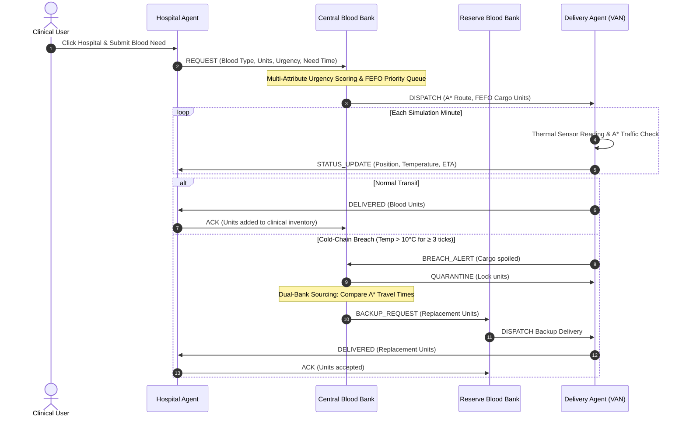

# Multi-Agent Blood Supply & Cold-Chain Management

> **Foundations of AI Case Study Demo**  
> An autonomous multi-agent logistics and cold-chain safety system built with Python, Streamlit, Plotly, NetworkX, and hand-crafted AI algorithms.

---

## 🌟 Overview & Clinical Context

In emergency healthcare logistics, blood supply management is a life-critical, constrained optimization problem. Blood products are highly perishable, exhibit strict immunological compatibility constraints, and must adhere to rigid cold-chain thermal boundaries ($1^\circ\text{C} - 10^\circ\text{C}$) during transit.

This system demonstrates a decentralized multi-agent system (MAS) where:
- **Hospital Agents** perceive local deficit, predict surgical demand, and negotiate for scarce donor units.
- **Blood Bank Agents** (Central and Reserve) prioritize contending clinical demands using a **multi-attribute greedy priority allocation** algorithm with **aging terms** (to eliminate starvation), **First-Expiry-First-Out (FEFO)** shelf-life sorting, and **compatible donor substitution**.
- **Delivery Agents** transport units across an urban road network, planning and dynamically re-planning routes using a **hand-crafted A\* search algorithm** with a mathematically admissible Euclidean heuristic.
- **Horn-Clause Safety Rule Engines** continuously monitor onboard thermal telemetry, executing emergency quarantines and triggering **dual-bank backup sourcing** from the Reserve Blood Bank upon sustained cold-chain failure.

---

## 🚀 Quick Setup & Execution

### 1. Prerequisites
- Python 3.11+ (Python 3.11, 3.12, or 3.13)
- Git

### 2. Environment Setup
```bash
# Clone the repository
git clone https://github.com/Gnanesh-12/Multi-Agent-Blood-Supply-and-Cold-Chain-Management.git
cd Multi-Agent-Blood-Supply-and-Cold-Chain-Management

# Create and activate virtual environment
python -m venv venv

# On Windows (PowerShell):
.\venv\Scripts\Activate.ps1
# On Windows (Command Prompt):
venv\Scripts\activate.bat
# On Linux/macOS:
source venv/bin/activate

# Install pinned dependencies
pip install -r requirements.txt
```

### 3. Launch the Interactive Dashboard
```bash
streamlit run app.py
```
Open [http://localhost:8501](http://localhost:8501) in your browser.

### 4. Run the Pytest Test Suite
```bash
pytest tests -v
```
All 16 unit and integration tests run in under 2 seconds, validating A* optimality, admissibility, greedy priority allocation, aging starvation prevention, FEFO, safety rules, and seed determinism.

---

## 🛠️ Why These Tools? (Tool/Package Selection & Setup)

| Package | Role in Architecture | Architectural Justification |
| :--- | :--- | :--- |
| **Streamlit (≥ 1.38)** | UI & Reactive State Presentation | Modern Streamlit features `@st.dialog` for interactive clinical intake modals and `st.plotly_chart(..., on_select='rerun')` for bidirectional point selection directly from the city map. Dark glassmorphism theme configured via `.streamlit/config.toml`. |
| **Plotly** | Spatial Map & Telemetry Visualizations | Renders interactive 2D city road topologies with traffic delay colorings, animated delivery vehicles, sequence-style agent message timelines, and real-time sensor temperature line charts with safety bands. |
| **NetworkX** | Graph Topology Storage | Used **strictly as a data structure** to store city road vertices, edge distances, speeds, and traffic delay factors. **No NetworkX shortest path algorithms are used.** |
| **Hand-Crafted A\*** | Autonomous Route Planning | Written from scratch using Python's `heapq`. Employs a mathematically proven admissible heuristic based on Euclidean distance divided by theoretical maximum speed. |
| **pandas** | Tabular Data Management | Structures allocation decision breakdowns, message logs, and safety rule audit trails for presentation and inspection. |
| **PyYAML** | Configuration Management | Fully externalizes nodes, coordinates, road properties, initial stocks, weights, and safety thresholds in `config/city.yaml` to ensure zero hardcoded topology. |
| **pytest** | Automated Verification | Validates heuristic admissibility, optimality against Dijkstra, FEFO sorting, horn-clause breach counters, and deterministic simulation execution. |

---

## 🧠 Core AI Algorithms & Mathematical Formulations

### 1. Multi-Attribute Urgency Scoring & Greedy Allocation
When hospitals contend for scarce donor units, the Central Blood Bank ranks all pending requests using a weighted multi-criteria utility function:

$$\text{Urgency Score} = w_1 \cdot U + w_2 \cdot \left(\frac{60}{\max(5, T_{need})}\right) + w_3 \cdot D + w_4 \cdot R + w_5 \cdot (\Delta t_{wait} \times 0.1)$$

Where:
- $U \in \{3.0, 2.0, 1.0\}$: Clinical urgency level (Emergency, Urgent, Routine).
- $T_{need}$: Time in minutes remaining until surgical need. Scaled inversely so imminent surgeries receive higher utility.
- $D = \max\left(0, \frac{\text{Target} - \text{Current}}{\text{Target}}\right) \times 3.0$: Hospital local stock deficit ratio.
- $R \in [0.2, 1.0]$: Rarity score of requested blood type ($O^-$ universal donor has $R = 1.0$).
- $\Delta t_{wait}$: Elapsed simulation minutes since request submission. **Aging term ($w_5$) prevents starvation of routine procedures under prolonged emergency contention.**

#### Allocation Workflow:
1. Requests are scored and loaded into a **max-heap** using Python's `heapq` ($O(N \log N)$ complexity).
2. The highest-scoring request is allocated first.
3. Available units are selected using **FEFO (First-Expiry-First-Out)**, sorting by expiration time ascending.
4. If exact stock is exhausted, the engine queries the **RBC Compatibility Matrix** (e.g. substituting $O^-$ for $A^-$, or $O^+$ for $B^+$) and flags the decision as `SUBSTITUTED`.
5. Every request receives an explicit decision record (`FULFILLED`, `PARTIAL`, `REFUSED`) with a human-readable explanation.

---

### 2. Hand-Crafted A\* Search Algorithm
Route navigation across the road network is computed using a custom A\* search:

$$\text{Cost}(u, v) = g(u, v) = \frac{\text{Distance}_{km}(u, v)}{\text{Effective Speed}_{km/h}(u, v)} \times 60.0 \quad [\text{minutes}]$$

$$\text{Effective Speed} = \frac{\text{Base Speed}}{\text{Delay Factor}}$$

#### Admissible Heuristic:
$$h(n, \text{Goal}) = \frac{\text{Euclidean Distance}_{km}(n, \text{Goal})}{\text{Max Speed}_{km/h}} \times 60.0$$

#### Proof of Admissibility & Consistency:
1. In Euclidean space, straight-line distance is the infimum of all physical road paths: $\text{Dist}_{euclidean}(n, \text{Goal}) \le \text{Dist}_{road}(n, \text{Goal})$.
2. The speed on any road cannot exceed $\text{Max Speed}$ (since traffic delay $\ge 1.0$).
3. Therefore, $h(n) \le g^*(n, \text{Goal})$. The heuristic never overestimates true travel time, guaranteeing optimal pathfinding.
4. Uninformed Dijkstra search is implemented as a baseline ($h(n) = 0$). In all test cases, $A^*$ explores fewer or equal nodes than Dijkstra while yielding identical travel times.

---

### 3. Horn-Clause Forward-Chaining Safety Rules
Safety checks are evaluated **every simulation tick prior to agent deliberations**:

- **Rule 1 (Hyperthermia Breach):**
  $$\text{Reading} > T_{max} \text{ for } \ge D \text{ consecutive readings} \implies \text{Quarantine}(\text{cargo}) \land \text{BREACH\_ALERT} \land \text{Trigger Backup}$$

- **Rule 2 (Hypothermia Breach):**
  $$\text{Reading} < T_{min} \text{ for } \ge D \text{ consecutive readings} \implies \text{Quarantine}(\text{cargo}) \land \text{BREACH\_ALERT} \land \text{Trigger Backup}$$

- **Rule 3 (Product Shelf-Life Expiry):**
  $$t_{sim} \ge \text{Expiry Time} \implies \text{Mark Status}(\text{unit}, \text{EXPIRED})$$

*Default Parameters:* $T_{min} = 1.0^\circ\text{C}$, $T_{max} = 10.0^\circ\text{C}$, $D = 3$ consecutive readings (configurable via sidebar).

#### Dual-Bank Backup Sourcing:
Upon a `BREACH_ALERT`, the system evaluates both Central Blood Bank and Reserve Blood Bank using A\* travel times:
$$t_{CBB} = \text{A}^*(CBB, \text{Hospital}), \quad t_{RBB} = \text{A}^*(RBB, \text{Hospital})$$
The fastest bank with viable compatible stock dispatches an emergency replacement vehicle (`is_backup=True`).

---

## 🤖 Multi-Agent Execution & Interaction Protocol

Agents communicate strictly by passing structured messages over a decoupled `MessageBus`.

### FIPA-ACL Communicative Performatives:
- `REQUEST`: Hospital requests blood units from Central Blood Bank.
- `PROPOSE` / `ACCEPT`: Negotiation and fulfillment confirmations.
- `REFUSE`: Bank communicates rejection due to stockout or incompatibility.
- `DISPATCH`: Bank assigns route and cargo to DeliveryAgent.
- `STATUS_UPDATE`: Delivery vehicle broadcasts live coordinates, temperature, and ETA.
- `BREACH_ALERT`: Thermal sensor failure alert emitted by delivery agent.
- `QUARANTINE`: Bank and hospital formally quarantine spoiled units.
- `BACKUP_REQUEST`: Emergency sourcing order sent to Reserve Blood Bank.
- `DELIVERED`: Vehicle arrives at hospital destination.
- `ACK`: Hospital inspects cargo and acknowledges clinical receipt.



---

## 🎮 Preset Demonstration Scenarios Walkthrough

Select any scenario from the **Preset Scenarios** dropdown in the sidebar to observe distinct AI capabilities:

### Scenario 1: Single Routine Request
- **Demonstration:** Baseline request handling, A\* pathfinding, and standard FIPA-ACL messaging.
- **Workflow:** City General (H1) requests 2 units of A+ (Routine). Central Blood Bank dispatches a vehicle, which travels along the expressway and completes delivery with `ACK`.

### Scenario 2: Two Hospitals Competing for Scarce O-
- **Demonstration:** Urgency scoring, contention resolution, and aging starvation prevention.
- **Workflow:** Available $O^-$ stock is restricted to 2 units. City General (H1) submits an **Emergency** need (15 min surgery), while Apollo (H3) submits a **Routine** need (120 min). Greedy allocation awards stock to H1. Apollo is deferred/refused with an explicit explanation.

### Scenario 3: Mass-Casualty Incident (4 Hospitals at Once)
- **Demonstration:** High-volume contention queue and multi-request priority ranking.
- **Workflow:** 4 hospitals submit simultaneous emergency trauma orders. Observe the **Allocation Decisions** table rank each request based on urgency, deficit, and rarity.

### Scenario 4: Temperature Breach Mid-Delivery → Backup from Reserve
- **Demonstration:** Cold-chain safety rules, horn-clause firing, and dual-bank backup sourcing.
- **Workflow:** A delivery vehicle travels toward Govt Medical College (H4). A heating failure spikes temperature above $10^\circ\text{C}$ for 3 consecutive readings. The rule engine fires, quarantining the cargo. Sourcing logic evaluates that the **Reserve Blood Bank** is closest to H4, immediately dispatching a backup vehicle.

### Scenario 5: Traffic Jam (A\* Dynamic Re-Routing)
- **Demonstration:** Real-time heuristic replanning under dynamic network delays.
- **Workflow:** A severe 3.0x traffic jam is injected onto the Central Arterial road. Delivery Agent re-evaluates remaining travel time with A\* and automatically reroutes around the perimeter avenue.

### Scenario 6: Stockout → Compatible Substitution
- **Demonstration:** Clinical RBC compatibility fallback.
- **Workflow:** Central Bank has 0 units of $B^+$. St. Mary's (H2) requests 3 units of $B^+$. Allocation substitutes compatible $O^+$ units and clearly flags the substitution in the decision log.

---

## 🏗️ Code Structure & Scalability

```
Multi-Agent-Blood-Supply-and-Cold-Chain-Management/
├── app.py                      # Streamlit UI presentation layer (no business logic)
├── requirements.txt            # Pinned dependencies
├── .streamlit/
│   └── config.toml             # Custom dark dashboard theme configuration
├── config/
│   └── city.yaml               # Network topology, nodes, roads, initial stock, thresholds
├── src/
│   ├── __init__.py
│   ├── blood.py                # BloodType enum, BloodUnit, FEFO sorting, RBC compatibility
│   ├── city.py                 # CityNetwork topology, Euclidean metric, delay modifiers
│   ├── messaging.py            # FIPA-ACL Performatives, Message dataclass, MessageBus
│   ├── rules.py                # Horn-clause SafetyRuleEngine (cold chain & expiry)
│   ├── simulation.py           # SimulationEngine: coordinator owning agents, bus, and clock
│   ├── ui_helpers.py           # Plotly figure generators (map, inventory, telemetry, timeline)
│   ├── agents/
│   │   ├── __init__.py
│   │   ├── base.py             # BaseAgent (perceive-decide-act lifecycle)
│   │   ├── hospital.py         # HospitalAgent
│   │   ├── blood_bank.py       # BloodBankAgent (Central & Reserve)
│   │   └── delivery.py         # DeliveryAgent (motion, thermal sensing, re-planning)
│   └── planning/
│       ├── __init__.py
│       ├── astar.py            # Hand-crafted A* Search and Dijkstra baseline
│       └── allocation.py       # Urgency scoring, FEFO priority allocation, substitution
└── tests/
    ├── __init__.py
    ├── test_astar.py           # A* optimality, admissibility, Dijkstra comparison
    ├── test_allocation.py      # Urgency scoring, FEFO, aging starvation, substitutions
    ├── test_rules.py           # Consecutive breach counter, noise resets, expiry
    └── test_scenarios.py       # End-to-end breach recovery, preset scenarios, determinism
```

### Scalability Principles:
1. **Config-Driven Architecture:** To add a 6th hospital or 3rd blood bank, simply add entry to `config/city.yaml`. No Python code modifications required.
2. **Headless Engine:** `SimulationEngine` has zero Streamlit imports, enabling automated CI testing and integration into headless test harnesses.
3. **Decoupled Messaging:** Agents communicate strictly via `MessageBus`, adhering to true distributed multi-agent system principles.
